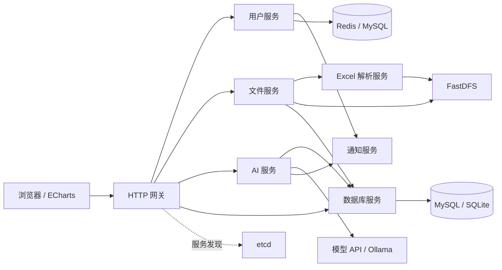

# Chat2Data · C++ 智能数据分析平台

将 Excel 和数据库转换为可以用自然语言查询的数据源。后端提供表结构与样例，引导大模型生成 SQL，由数据库执行，再结合真实结果生成分析说明、表格和图表。

基于 [zhibite-edu/chat2data-tech](https://gitee.com/zhibite-edu/chat2data-tech) 课程项目整理，保留完整业务主链路，用于项目复习、源码阅读和持续开发。来源与整理改动见 [UPSTREAM.md](UPSTREAM.md)。

## 核心能力

- **数据接入**：Excel 多工作表解析、表头规范化、字段类型推断、动态建表与分批 INSERT。
- **自然语言查询**：数据源上下文构造、SQL 提取与校验、数据库执行、结果解释及结构化图表数据。
- **流式交互**：模型输出经 AI 服务、网关逐段转发，浏览器通过 HTTP/SSE 展示增量内容。
- **数据库适配**：MySQL / SQLite 驱动抽象、工厂创建、连接状态管理和空闲回收。
- **用户与会话**：用户认证、Redis 缓存、对话管理与资源归属校验。
- **服务协作**：brpc / Protobuf 内部调用、etcd 服务发现、FastDFS 文件存储和邮件通知。

## 架构



**数据导入**：上传文件 → 保存文件与元数据 → 解析工作表 → 建表与分批入库。

**数据分析**：问题 → 表结构和样例 → 模型生成 SQL → 数据库执行 → 模型解释 → 流式文字及结构化结果。

## 源码导航

| 目录 / 文件 | 阅读重点 |
| --- | --- |
| `svc_gatewayService/` | HTTP 路由、认证、服务转发、流式代理 |
| `svc_gatewayService/API.md` | 上游接口说明；具体行为以路由实现为准 |
| `svc_aiService/aimessageHandler.cc` | SQL 生成、执行与总结的核心编排 |
| `svc_aiService/userPrompt.h` | 模型提示词与响应结构约定 |
| `svc_excelParserService/excelParser.cc` | 表头处理、单元格解析和类型推断 |
| `svc_fileService/fileBusiness.cc` | 文件存储、工作表映射和导入协调 |
| `svc_dbService/dbBusiness.cc` | 动态建表、批量导入与 SQL 执行 |
| `svc_dbService/dbDriver/` | 数据库接口、工厂、MySQL / SQLite 实现 |
| `svc_dbService/dbConnMgr.cc` | 连接生命周期、锁与后台回收 |
| `svc_userService/` | 用户逻辑与登录会话 |
| `svc_notifyService/` | 邮件任务队列与后台发送 |
| `common/` | SQL 校验、错误处理和工具函数 |
| `proto/` | 六组内部服务协议 |
| `data/` | 数据访问层、实体、ODB 生成代码和初始化 SQL |
| `www/` | 登录、文件管理、聊天及图表页面 |
| `test/` | 数据库驱动及用户数据访问测试源码 |
| `config/` | 七个服务的独立配置示例 |

建议阅读顺序：`proto/` → 网关路由 → 文件导入 → AI 编排 → 数据库驱动与连接管理 → 用户会话。

## 构建前提

目标环境为 **Linux + C++17 + CMake**。源码使用 Linux 系统接口，建议在原课程 Linux 环境或等价依赖环境中构建。

需要的主要依赖：

- brpc、Protobuf（含 `protoc`）、OpenSSL、LevelDB、gflags。
- MySQL 客户端、SQLite3、ODB / ODB MySQL runtime。
- Redis++、hiredis、etcd-cpp-api、cpprestsdk。
- OpenXLSX、FastDFS client、fastcommon、libcurl。
- spdlog、fmt、JsonCpp、nlohmann/json、cpp-httplib。
- 课程配套库 **`bite_scaffold`** 与 **`ai_chat_sdk`**，以及对应头文件。
- GoogleTest（仅测试需要）。

`bite_scaffold` 和 `ai_chat_sdk` 的完整实现不在上游主工程内，本仓库没有用二进制文件代替这些依赖。请先在课程环境中安装或构建它们，并让编译器和链接器能够找到。

```bash
cmake -S . -B build
cmake --build build --parallel 4
cp -R www bin/www
```

构建输出位于 `bin/`，Protobuf 代码由 CMake 生成。保留 `data/odb/` 中被当前构建直接引用的生成代码；修改实体后需用兼容的 ODB 工具重新生成。

本次仓库整理完成了源码路径、配置示例和发布内容检查；尚未在当前本机环境执行 Linux 全量编译与业务联调。

## 配置与运行

### 1. 准备基础服务

启动 MySQL、Redis、etcd 和 FastDFS；需要邮件验证码时配置 SMTP，需要模型分析时配置对应模型 API 或 Ollama。

在**专用的项目数据库环境**中按 `data/sql/` 文件名前缀顺序执行初始化 SQL。执行前检查 SQL 中的 DROP 语句与目标数据库，避免覆盖已有数据。

### 2. 创建本地配置

```bash
for template in config/*.conf.example; do
  target="${template%.example}"
  if [ ! -e "$target" ]; then
    cp "$template" "$target"
  fi
done

if [ ! -e .env ]; then
  cp .env.example .env
fi
```

编辑 `config/*.conf` 中的数据库、Redis、FastDFS、SMTP 和服务地址。示例使用同一台 Linux 主机的回环地址；跨主机运行时，应将注册地址改成调用方能够访问的地址。

编辑 `.env`，填入所使用模型的密钥。启动 AI 服务前执行：

```bash
source .env
```

环境变量名保持与现有 SDK 调用一致：`deepseek_apikey`、`chatgpt_apikey`、`gemini_apikey`。未使用的提供商保留为空，仅选择已完成配置的模型。

### 3. 启动服务

从仓库根目录在独立终端或进程管理器中分别启动：

| 服务 | 命令 | 示例端口 |
| --- | --- | --- |
| 通知 | `./bin/NotifyService --conf=config/notify.conf` | 8002 |
| Excel 解析 | `./bin/ExcelParserService --conf=config/excel.conf` | 8003 |
| 数据库 | `./bin/dbService --conf=config/database.conf` | 8005 |
| 用户 | `./bin/UserService --conf=config/user.conf` | 8001 |
| 文件 | `./bin/FileService --conf=config/file.conf` | 8004 |
| AI | `./bin/AIService --conf=config/ai.conf` | 8006 |
| 网关 | `./bin/GatewayService --conf=config/gateway.conf` | 8000 |

网关最后启动。浏览器访问 `http://localhost:8000`，前端 API 使用同源地址。将后端 RPC 端口限制在开发环境内部，不直接暴露到互联网。

## 测试与实现边界

保留的测试覆盖数据库 schema、SQL 校验、数据库工厂、MySQL / SQLite 驱动，以及用户、会话和验证码数据访问。测试中包含数据库创建、删除或清理操作，应使用隔离的测试实例，先修改测试连接参数再运行。

阅读和进一步开发时，重点关注：

- Excel 类型推断依赖样例，需考虑混合类型、编号和重名字段。
- 分批 INSERT 不等于整个文件导入具有事务原子性。
- 连接管理器与连接池不同，连接并发使用、活跃时间更新和回收需要统一协调。
- Redis 缓存 TTL 与登录会话业务有效期应分开处理。
- 生成 SQL 的字符串校验不能代替最小权限、资源授权和执行限制。
- 流式链路需继续完善取消传播、慢客户端处理和后台任务退出。

## 许可证

主体项目遵循 [Mulan PSL v2](LICENSE)，保留上游声明与来源。内置 Apache ECharts 5.4.3 使用其自身许可证，见 [LICENSE](third_party/ECHARTS-LICENSE) 与 [NOTICE](third_party/ECHARTS-NOTICE)。
